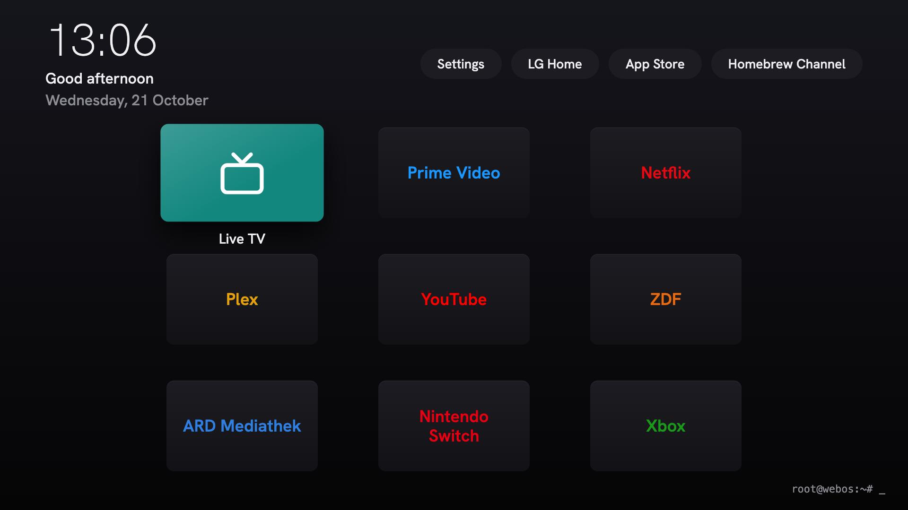

# lgtv-webos-root-launcher

A minimal custom launcher for rooted LG OLED TVs from 2021 (webOS 6). It shows a 3x3 tile grid in the style of the Apple TV home screen, with a bar at the top for the time and a few system buttons. A tile starts an app, an HDMI input or Live TV. The repository also holds a step-by-step guide to root the TV, switch off LG's telemetry, hide unwanted apps and install the launcher.

> [!TIP]
> This project works best together with your preferred coding agent, for example Claude Code, OpenCode or Codex. Open the repository in the agent and ask it to read this README, [docs/guide.md](docs/guide.md) and [docs/known-traps.md](docs/known-traps.md). It can then walk you through the setup step by step, run the checks for you and change tiles, texts or colours in a few minutes.



> Disclaimer: This is an unofficial hobby project. It is not affiliated with or endorsed by LG Electronics. Use it only on a TV you own. Rooting a TV can brick it and can void its warranty, and the guide blocks LG's firmware updates on purpose. There is no support. You use everything here at your own risk.

## Tested on

The setup was built and checked on one TV:

| Fact | Value |
|---|---|
| Model | LG OLED55B19LA (2021) |
| Firmware | 03.53.45 |
| webOS | 6.5.3-47 |

Nothing else was tested.

## Other models

Other 2021 series may work, but nobody has checked. If you own another model or firmware, verify before you trust a layer: give [docs/guide.md](docs/guide.md), [docs/known-traps.md](docs/known-traps.md) and [CONTEXT.md](CONTEXT.md) to your own AI agent and let it compare the paths, key codes and services on your TV with the ones named here. The steps are in [Other models](docs/guide.md#6-other-models). The root tools also change over time, so read the current notes of the upstream projects before you start ([SlopBro](https://github.com/throwaway96/slopbro), [Homebrew Channel](https://github.com/webosbrew/webos-homebrew-channel)).

## Getting started

Requirements:

- A Mac. The scripts use macOS tools (`ipconfig`, `shasum`); Linux and Windows hosts are not supported.
- `ares-cli`, Node 22 or newer, Python 3, `git`, `curl`, `ssh` and `scp`.
- The TV on a wired network with a fixed address, on the same network as the Mac.

Set the TV's address in every terminal you use. The scripts stop with a message when it is missing.

```sh
export TV_IP=192.0.2.18                   # the address of your TV
export TV_KEY=~/.ssh/lgtv_root_ed25519    # optional, this is the default
```

Then follow [docs/guide.md](docs/guide.md) in order:

1. Root the TV.
2. Switch off telemetry and ads (hosts file, settings, optional Pi-hole).
3. Hide apps and stop preloading.
4. Install the launcher.
5. Customise tiles, toolbar, greeting, HOME key code and boot input.

Every step has a check and an undo.

## Contents

- [Limits](#limits)
- [Install](#install)
- [Controls](#controls)
- [Tiles and toolbar](#tiles-and-toolbar)
- [Design](#design)
- [How it works on the TV](#how-it-works-on-the-tv)
- [Logs and checks](#logs-and-checks)
- [Roll back the launcher](#roll-back-the-launcher)
- [Restore the custom state](#restore-the-custom-state)
- [Development](#development)
- [Add your own logos](#add-your-own-logos)
- [Trademarks](#trademarks)
- [Credits and licence](#credits-and-licence)
- [Further docs](#further-docs)

One IPK holds two parts:

- the web app `lgtv.blueprint.launcher`: plain HTML, CSS and JavaScript, no framework, no bundler
- the Luna service `lgtv.blueprint.launcher.service`: opens the launcher at power-on and on the HOME key

The only build tool is `ares-package`. The service relies on a rooted TV (Homebrew Channel, root SSH).

## Limits

- The launcher does not replace the LG home screen. It is a normal web app that the service brings to the front. LG Home is still there behind it.
- A web app cannot list the installed apps. The tiles come from `app/catalog.json`, which a script generates on the Mac (see [Tiles and toolbar](#tiles-and-toolbar)).
- Developer Mode is gone and must not be reinstalled while the TV is rooted. `ares-install` fails on the tested firmware, so the install goes through the app install service.

## Install

Root SSH to the TV must work (guide step 1). The scripts read `TV_IP` (required) and `TV_KEY` (optional, default `~/.ssh/lgtv_root_ed25519`).

The `ssh` commands in this README are written in the short form `ssh root@$TV_IP`. Add `-i ~/.ssh/lgtv_root_ed25519 -o IdentitiesOnly=yes`, or put a host entry with that key into `~/.ssh/config`.

```sh
scripts/package.sh       # builds dist/lgtv.blueprint.launcher_1.0.0_all.ipk (app + service)
scripts/install-root.sh  # installs it on the TV and arms the autostart
```

`install-root.sh` does three things:

1. It copies the IPK with `scp` and installs it through the app install service.
2. It copies `scripts/root/30-preload-off.sh` and the boot hook `40-home-reset` to the TV.
3. It links the boot hook `50-launcher` to `service/autostart.sh` and runs it once. The hook elevates the service again, because every install resets its Luna permissions, and starts it.

At the end the script prints the commands to check the install.

### Power On Screen setting

The TV setting "Power On Screen" (`general.homeAutoLaunch`) must be `off`. Otherwise a mains cycle opens LG Home instead of the launcher. `scripts/restore-custom-state.sh` sets it as well. By hand:

```sh
ssh -tt root@$TV_IP 'luna-send -n 1 luna://com.webos.settingsservice/setSystemSettings "{\"category\":\"general\",\"settings\":{\"homeAutoLaunch\":\"off\"}}"'
```

## Controls

- Arrow keys move the focus in the grid. Up from the top row jumps into the bar, onto the button closest to the tile. Down from the bar returns to the grid. In the bar, Left and Right move the focus.
- OK (Enter) starts the tile or button. Back (key code 461) does nothing.
- Only the focused tile shows its name.
- HOME on the remote opens the launcher from any app. On the launcher itself it does nothing.
- INPUT on the remote opens LG's Home Dashboard with the list of inputs. It is the only way to switch inputs outside the launcher, so the Home Dashboard must not be hidden.

## Tiles and toolbar

### Generate the tiles

`scripts/build-catalog.mjs` pairs with the TV over the local network (SSAP), reads its launch points and writes `app/catalog.json`. Tiles without a `logo` get the TV's icon, which the script downloads to `app/icons/`. It needs Node 22 or newer (no packages) and the TV switched on at `$TV_IP`. Run it from the repo root:

```sh
node scripts/build-catalog.mjs
```

- On the first run the TV shows a pairing prompt. Confirm it with the remote within 60 s. The script stores the key in `~/.config/lgtv-webos-root-launcher/client-key` (readable only by the user, not in the repo).
- The complete app list from the TV goes to `docs/all-apps.json`. Wanted entries without a match are printed and left out of the catalog.
- The TV uses a self-signed certificate. The script therefore sets `NODE_TLS_REJECT_UNAUTHORIZED=0` for its own process, and Node prints a warning. The script talks only to the TV.

The new tiles reach the TV only with the next build and install (`scripts/package.sh`, `scripts/install-root.sh`).

### Choose the tiles

`scripts/wanted-apps.json` is an ordered list with one entry per tile:

| Field | Meaning |
|---|---|
| `title` | name of the tile |
| `match` | compared with the app title, ignoring case; an exact match wins over a partial one |
| `appId` | used instead of `match` to assign the app directly, as for Live TV and the HDMI inputs |
| `color` | brand color (hex) |
| `logo` | symbol in `app/logos.svg`; `livetv` stands for `logo-livetv` |

The example maps two tiles to HDMI 2 and 3. Change their `appId` to match what is plugged into your TV.

Each entry in `app/catalog.json` has `title`, `appId` and optionally `color`, `logo` and `icon` (path relative to `app/`). The entries fill the grid in reading order. The grid has room for nine tiles; a fourth row does not fit on the screen.

### Toolbar

The buttons at the top come from `app/toolbar.json` (`title` and `appId` per entry). The file is maintained by hand; `build-catalog.mjs` does not touch it. Current buttons: Settings (`com.palm.app.settings`), LG Home (`com.webos.app.home`), App Store (`com.webos.app.discovery`), Homebrew Channel (`org.webosbrew.hbchannel`).

## Design

### Layout

- The app is built for 1920x1080. The top 270 px are the bar: time, greeting and date on the left, the toolbar buttons as small round pills on the right. The 3x3 grid sits below.
- The greeting depends on the hour: 5 to 11 "Good morning", 12 to 17 "Good afternoon", 18 to 22 "Good evening", otherwise "Still up?" (`greetingFor` in `app/main.js`). Clock and greeting update once per minute.
- Bottom right shows a static root prompt `root@webos:~# _` (text in `app/index.html`). It uses Droid Sans Mono, which the TV ships, and falls back to the system monospace font.

### Tiles and focus

- Tiles are 5:3, slightly rounded and dark graphite with a fine light edge at the top. The logo sits in the middle in the brand color.
- The project ships one symbol, the Live TV symbol in `app/logos.svg`, drawn for this app. A tile without a logo shows the TV's icon, and a tile without an icon shows the app name in the brand color. Brand logos are not included, see [Add your own logos](#add-your-own-logos).
- On focus the tile grows by 8 %, a layer in the brand color with a static sheen fades in, and the logo turns white. On very bright colors such as yellow the logo turns dark instead (threshold `DARK_TEXT_MIN_LUMINANCE` in `app/main.js`).
- Each tile holds the logo twice (`mark-rest`, `mark-focus`), so the focus change is a pure `opacity` fade.
- Bar buttons grow and turn white on focus.

### Font

Hanken Grotesk, one variable woff2 in `app/fonts/` (Latin only, 35 KB, SIL Open Font License in `app/fonts/OFL.txt`). The clock uses weight 200 with tabular figures, everything else weight 500.

### Performance rules

The TV has a weak chip, so the app keeps to these rules:

- animate only `transform` and `opacity` (150 ms `ease-out`)
- put the soft shadow on a pseudo-element and change only its `opacity`
- no `blur` or `backdrop-filter`
- no external requests
- a calm dark gradient as background

### Where to change things

| What | Where |
|---|---|
| colors, sizes, gaps, focus scale, bar height | CSS variables at the top of `app/style.css` (`--tile-width`, `--tile-height`, `--column-gap`, `--row-gap`, `--focus-scale`, `--top-height`) |
| column count (3) | `grid-template-columns` in `app/style.css` and `GRID_COLUMNS` in `app/main.js` |
| structure | `app/index.html`; tiles and buttons are built in `app/main.js` (`createTile`, `createToolbarButton`) |
| tiles and brand colors | `scripts/wanted-apps.json`, then rerun `build-catalog.mjs` |
| top buttons | `app/toolbar.json` |
| app ID, version, icons | `app/appinfo.json` (`lgtv.blueprint.launcher`, `icon.png` 80x80, `largeIcon.png` 130x130) |

## How it works on the TV

The service does the work that a web app is not allowed to do. It starts at boot, watches the power state and the HOME key, and launches privileged targets for the app. The terms used here (takeover, input stand-in, settle guard and others) are defined in [CONTEXT.md](CONTEXT.md).

### Autostart

Homebrew Channel runs `/var/lib/webosbrew/init.d/50-launcher` on every cold boot, about 41 s after power-on. The hook is a symlink to the installed `service/autostart.sh` and starts the service in the background with `--boot --watch`.

The service then watches the TV power state. When the state becomes `Active`, it waits 2 s and opens the launcher. It tries up to 4 times, 1.5 s apart, until the launcher is in front. The end of the screen saver does not count as power-on, so it starts no launch.

### Power-on and last input

At power-on bootd opens the app named in `/var/lib/eim/lastinput`. The service writes two fields into this file:

- `physicalLastSourceAppId` becomes `lgtv.blueprint.launcher`, so the TV opens the launcher instead of the last HDMI input.
- `physicalLastSourceId` becomes `HDMI_1`. bootd starts that input at power-on, and with `DTV` it would tune the last channel behind the launcher. Choose an input with nothing plugged in; a powered device there could be heard at boot (see the guide, "Boot input").

The service writes the file when the takeover is armed and at power-off. The system writes every input it switches to into the same file, so the heartbeat also checks it once per second and writes it again if needed. The original file is kept as `/var/lib/webosbrew/lastinput.orig`.

At power-off the service also closes Live TV. Otherwise Live TV keeps its audio running, muted, behind other apps.

### Mains start

After a mains start bootd opens `com.webos.app.inputcommon` under the launcher's name instead of the web app, and the screen is black. The service detects this input stand-in by `windowGroup` `true` in `getForegroundAppInfo {"extraInfo":true}` and launches the real launcher. The screen stays black until about 52 s after power-on.

### Settle guard

For 45 s after a power-on or wake launch, a guard reopens the launcher if LG Home takes the front. If the system left Live TV connected to the video sink (sound under the menu), the guard opens Live TV for about 2 s and then the launcher again. An HDMI input on the sink is left alone.

### HOME key

With `--watch` the service reads every `/dev/input/event*` device read-only. It never grabs them, so the remote keeps working. Every 100 ms it checks for key code 773, the HOME key of the Magic Remote on the tested TV. Other remotes can use another code; the guide shows how to measure yours. A press opens the launcher.

While the service runs, it switches off the system's own HOME handling (`com.webos.surfacemanager.disableHome=true`), so that LG Home does not fight for the front. It switches it back on when it exits. The value survives a reboot, so the hook `40-home-reset` and `autostart.sh` reset it to `false` at every boot. Without the service, HOME opens LG Home again.

### Wake

A heartbeat runs once per second. It looks for a wall-clock gap above 10 s that `/proc/uptime` shows as well, which means a real wake from suspend, and then reopens the launcher. A gap that only the wall clock shows is an NTP clock jump and is ignored. With Quick Start+ off the TV does not suspend, so in practice power-on goes through the power state and `lastinput`.

### Fail-safe

The service takes over HOME and the power-on screen only after it has seen the launcher in front once. From then on the takeover is armed.

The takeover fails if a launch is refused (for example `-102 app is locked`), if the launcher is not in front after the retries, or if it is not in front 3 s after a HOME launch. The service then sets `disableHome=false`, restores the original last input, logs `takeover FAILED` and stays passive until it is restarted.

To test this path, start the service with `--inject-launch-id=<app id>` or call its method `injectLaunchId`. The service then launches that ID instead of the launcher.

### Launch path

Tiles and toolbar buttons call `luna://lgtv.blueprint.launcher.service/launch {id, params}`. Through the service they can also open privileged targets such as Live TV and the HDMI inputs. If the service returns an error or does not answer within 3 s, the app launches the target directly through `applicationManager/launch`. It then shows the reason as red text on the right, below the top bar.

Now and then an HDMI input comes to the front without a picture: the screen stays black, not even "No Signal" shows. Three seconds after an HDMI tile, the service checks whether the input is still in front and has joined the video output. If not, it closes the input and opens it again, once.

### Service code

| File | Content |
|---|---|
| `service/service.js` | wiring: Luna methods `launch`, `injectLaunchId` and `status`, power subscription, input devices, timers |
| `service/takeover.js` | takeover rules: launch sequence, settle guard, HOME, wake, fail-safe, restart of a black HDMI input |
| `service/last-input.js` | last-input override and its restore |
| `service/input.js` | parser for the 16-byte `input_event` records |
| `service/autostart.sh` | boot hook `50-launcher` |

`takeover.js`, `last-input.js` and `input.js` are covered by `node --test`. The terms are defined in [CONTEXT.md](CONTEXT.md); pitfalls of the firmware are in [docs/known-traps.md](docs/known-traps.md).

## Logs and checks

- Service log with uptime: `/tmp/launcher-service.log`. The line `watching for key code 773 (--watch)` shows that the HOME watch runs, the line `takeover armed` that the service holds HOME and the power-on screen.
- PID: `/tmp/launcher-service.pid`. Elevation log: `/tmp/launcher-elevate.log`.
- `luna-send` prints nothing without a terminal. Use `ssh -tt` for every `luna-send` call.

```sh
ssh root@$TV_IP 'tail -n 40 /tmp/launcher-service.log'
ssh root@$TV_IP 'kill -0 $(cat /tmp/launcher-service.pid) && echo alive'
ssh -tt root@$TV_IP 'luna-send -n 1 luna://com.webos.applicationManager/getForegroundAppInfo "{\"extraInfo\":true}"'
ssh root@$TV_IP 'sh /var/lib/webosbrew/init.d/50-launcher'   # restart the service
```

The real launcher in front shows one window with `appId` `lgtv.blueprint.launcher` and `windowGroup` `false`. The input stand-in shows `windowGroup` `true`.

More pitfalls of this firmware and its tools: [docs/known-traps.md](docs/known-traps.md).

## Roll back the launcher

Run all four steps. Running only some of them leaves the TV in a worse state than the launcher itself.

```sh
# 1 hooks off for the next boot
ssh root@$TV_IP 'rm /var/lib/webosbrew/init.d/50-launcher /var/lib/webosbrew/init.d/40-home-reset'
# 2 stop the service (SIGTERM sets disableHome=false; it does not restore lastinput)
ssh root@$TV_IP 'kill $(cat /tmp/launcher-service.pid)'
# 3 original last input back
ssh root@$TV_IP 'cp /var/lib/webosbrew/lastinput.orig /var/lib/eim/lastinput'
# 4 Power On Screen back to LG's default
ssh -tt root@$TV_IP 'luna-send -n 1 luna://com.webos.settingsservice/setSystemSettings "{\"category\":\"general\",\"settings\":{\"homeAutoLaunch\":\"on\"}}"'
```

Check that `disableHome` is `false`:

```sh
ssh -tt root@$TV_IP 'luna-send -n 1 luna://com.webos.service.config/getConfigs "{\"configNames\":[\"com.webos.surfacemanager.disableHome\"]}"'
```

After a `reboot` the TV shows the last input with "No Signal" if nothing is plugged in there, not LG Home, because bootd opens the last input. Press HOME or call `luna://com.webos.applicationManager/launch {"id":"com.webos.app.home"}` to get LG Home. A mains cycle was not tested in this state.

Removing only `50-launcher` is not a rollback. `lastinput` still names the launcher, so bootd opens the input stand-in, no service runs and the screen stays black. HOME opens LG Home only once `40-home-reset` has run, about 41 s after boot.

To arm the launcher again after a rollback, restore both hooks, set `homeAutoLaunch` to `off` and run `sh /var/lib/webosbrew/init.d/50-launcher`. Details: [docs/guide.md](docs/guide.md), "Complete rollback".

## Restore the custom state

`scripts/restore-custom-state.sh` puts the whole TV back into the custom state with one command: root, privacy layers, hidden apps, preload and the launcher. Each layer checks first and skips what is already right, so a second run changes nothing. At the end the script reboots the TV, checks each layer and prints one line per layer.

```sh
scripts/restore-custom-state.sh --soft             # TV still rooted, settings or hooks lost (default)
scripts/restore-custom-state.sh --full             # TV lost root: factory reset or firmware change
scripts/restore-custom-state.sh --soft --dry-run   # only print the steps
```

More options: `--tiles` also rebuilds `app/catalog.json` from the TV. `--skip-pihole` leaves the Pi-hole layer out; without `PIHOLE_URL` the layer is skipped anyway, because the Pi-hole is optional.

| Layer | What it does | Source |
|---|---|---|
| launcher | builds and installs the IPK, hooks `40-home-reset` and `50-launcher` | `scripts/install-root.sh` |
| hosts-blocklist | hook `10-hosts-blocklist` and `blocklist.hosts` | `scripts/root/` |
| hidden-apps | writes the list from `scripts/root/debloat-ids.txt` and makes the region file in `blockedAppList/` immutable (`chattr +i`), because the TV resets it at boot | `scripts/root/webos-debloat.sh` |
| preload-off | `30-preload-off.sh` | `scripts/root/` |
| tv-settings | `homeAutoLaunch` off and the four privacy keys | `scripts/root/apply-settings.sh` |
| pihole-rules | adds the missing TV rules; needs `PIHOLE_URL` and `PIHOLE_PASSWORD` | `scripts/pihole-rules.mjs`, `scripts/root/pihole-rules.json` |

### Full restore

`--full` starts with `scripts/root/bootstrap-root.sh`. It installs [SlopBro](https://github.com/throwaway96/slopbro) and [Homebrew Channel](https://github.com/webosbrew/webos-homebrew-channel) at pinned versions (SHA-256 checked) and then sets up the SSH key and the update block. The script pauses for two manual steps: the TV setup after the reset (decline all optional consents) and Quick Start+ off in the TV menu. Confirm the SlopBro pairing prompt on the remote.

### Hidden apps

Only five of the 41 hidden IDs are tiles in LG Home on the tested TV: LG Channels, Art Gallery, Sports Alert, Alexa and 8 Ball Pool. The other 36 are not visible anyway, so hiding them changes nothing on screen.

A hidden app cannot be launched at all (`not exist`), not even by the system. The Home Dashboard (`com.webos.app.homeconnect`) was hidden once and took the INPUT key with it, so it stays visible.

Why the TV resets the list at boot is unproven. To undo the hidden-apps layer, run `chattr -i` on the region file, copy `/var/lib/webos-debloat/<region>.json.orig` over it and reboot.

### Not covered

The script does not touch the TV firmware, the consent flags (set during the TV setup) or the DNS settings on the router.

### Test status

What ran on the tested TV:

- Pi-hole layer: tested against a real Pi-hole.
- Settings script and debloat `--plan`/`--apply --dry-run`: all "already set", 41 apps would be hidden.
- Hidden-apps layer: ran twice with no change. The immutable list held through two reboots and one mains cycle.
- `--full`: never run end to end, because that needs a factory reset. `bootstrap-root.sh --dry-run` only checks the downloads and pins.

## Development

### Repository layout

| Path | Content |
|---|---|
| `app/` | the web app: `index.html`, `main.js`, `style.css`, `catalog.json` (tiles), `toolbar.json` (top buttons), `logos.svg`, font, icons |
| `service/` | the Luna service `lgtv.blueprint.launcher.service` (ES5, Node 8 on the TV) and its boot hook `autostart.sh` |
| `scripts/` | scripts that run on the Mac |
| `scripts/root/` | scripts, boot hooks and lists that run on the TV |
| `test/` | `node --test` tests for the service and the scripts |
| `docs/` | the guide, known traps and the preview image |
| `CONTEXT.md` | terms of the launcher service |
| `dist/` | build output (not in git) |

Scripts on the Mac (`scripts/`):

| Script | Purpose |
|---|---|
| `package.sh` | builds the IPK |
| `install-root.sh` | installs the IPK and the boot hooks on the rooted TV |
| `build-catalog.mjs` | generates `app/catalog.json` and `app/icons/` from the TV |
| `resolve-wanted-apps.mjs` | matches `wanted-apps.json` against the TV's launch points (used by `build-catalog.mjs`) |
| `wanted-apps.json` | list of wanted tiles |
| `restore-custom-state.sh` | restores the whole custom TV state |
| `pihole-rules.mjs` | adds the missing Pi-hole rules for the TV; `--check` only reports |
| `find-missing-rules.mjs` | finds the rules that are not in the Pi-hole yet (used by `pihole-rules.mjs`) |

Scripts and lists on the TV (`scripts/root/`):

| File | Purpose |
|---|---|
| `10-hosts-blocklist`, `blocklist.hosts` | boot hook that bind-mounts a copy of `/etc/hosts` with the LG ad, telemetry and update hosts blocked |
| `30-preload-off.sh` | stops app preloading for a fixed list of apps; `--restore` undoes it |
| `40-home-reset` | boot hook that gives HOME back to LG at every boot |
| `apply-settings.sh` | sets `homeAutoLaunch` and the four privacy keys |
| `webos-debloat.sh`, `debloat-ids.txt` | hides the apps in the ID list |
| `hide-launch-points.sh` | removes the launch points of the apps in an ID list |
| `bootstrap-root.sh`, `phase1-bootstrap.sh` | roots a TV that lost root and makes SSH access permanent |
| `pihole-rules.json` | Pi-hole rules of the privacy layer |

### Preview in a browser

`catalog.json`, `toolbar.json` and `logos.svg` load via XHR, which does not work over `file://`. Start a small server:

```sh
cd app && python3 -m http.server 8765
```

Open `http://localhost:8765/index.html` at 1920x1080. Without `PalmServiceBridge` a launch only shows the line `[browser mode] launch ...` below the top bar.

### Tests and checks

Run from the repo root:

```sh
node --test                                                                # unit tests
node --check service/service.js service/takeover.js service/last-input.js  # syntax
npx --yes es-check@7 es5 'service/*.js'                                    # service stays ES5
```

### Runtime limits

- The app runs on Chromium 79: no syntax newer than ES2017 (no `?.`, no `??`).
- The service runs on the TV's Node 8 and is written in ES5.
- `ares-package` warns about `requiredACG`. webOS 6 does not need the field.

## Add your own logos

The project ships no brand logos on purpose. Logos of companies and products are trademarks, and a licence for the drawing does not give you the right to use the brand. Tiles without a logo show the TV's icon or the app name in the brand color.

To add a logo for your own use:

1. Get a single-color SVG of the logo, for example from [Simple Icons](https://simpleicons.org/).
2. Add it to `app/logos.svg` as `<symbol id="logo-<name>">`. Cut its `viewBox` tight around the logo and leave the paths without their own `fill`.
3. Set `"logo": "<name>"` on the entry in `scripts/wanted-apps.json`.
4. Run `node scripts/build-catalog.mjs`, then `scripts/package.sh` and `scripts/install-root.sh`.

Pick the brand color so that the colored logo on graphite and the white logo on the brand color both reach a contrast of at least 3:1.

Keep brand logos in your own copy. Do not publish them in a public fork.

## Trademarks

LG, webOS and all app and service names mentioned here belong to their owners. This project is not affiliated with, authorized by or endorsed by any of them.

## Credits and licence

The project is released under the MIT licence, see [LICENSE](LICENSE). It builds on work by others: webos-custom-home, the webos-debloat gist, Glasshouse, lg-tv-blocklist and the Hanken Grotesk font. Sources, revisions, licences and copyright lines are in [THIRD-PARTY-NOTICES.md](THIRD-PARTY-NOTICES.md).

Rooting relies on [SlopBro](https://github.com/throwaway96/slopbro) by throwaway96 and [Homebrew Channel](https://github.com/webosbrew/webos-homebrew-channel) by the webosbrew project. `scripts/root/bootstrap-root.sh` downloads both at a pinned version when you run it, so neither is part of this repository.

## Further docs

- [docs/guide.md](docs/guide.md): step-by-step guide (root, privacy, debloat, install, customise, other models)
- [docs/known-traps.md](docs/known-traps.md): pitfalls of this firmware and its tools
- [CONTEXT.md](CONTEXT.md): terms of the launcher service
- [THIRD-PARTY-NOTICES.md](THIRD-PARTY-NOTICES.md): credits and licences of third-party material
